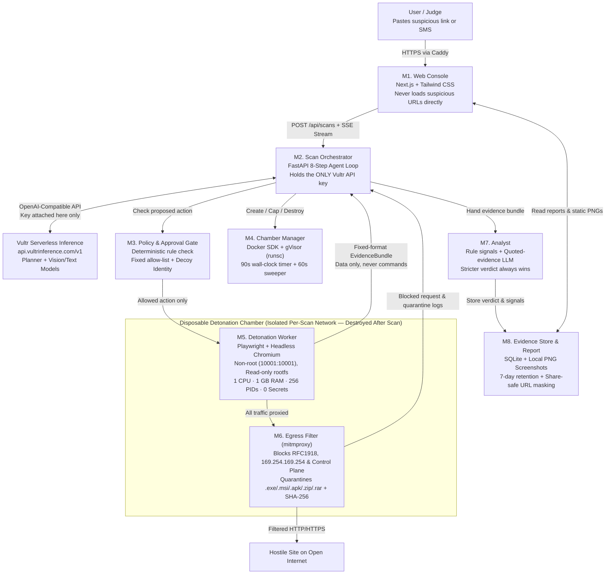

# BaitBox — A Disposable Detonation Chamber for Suspicious Links

> **Vultr Agent Rush Hackathon — Track 01: Blast Radius Zero (Pattern B, Sandboxed Browser Agent)**
> *"Let the box take the bait."*

[](./LICENSE)
[](https://lablab.build/ai-hackathons/vultr-hackathon)
[](https://www.vultr.com/)
[](https://api.vultrinference.com/v1)

---

## 1. What BaitBox Does

**BaitBox** lets anyone paste a suspicious link (or an entire SMS / WhatsApp message containing a link) and receive a **plain-language verdict** (`Likely safe`, `Suspicious`, or `Dangerous`), backed by hop-by-hop screenshots and a visible **Containment Report**, without their own phone or laptop ever touching the page.

When a link is submitted:
1. An AI browser agent opens the URL inside a **throwaway, secret-free container** on **Vultr Cloud Compute**.
2. It follows every redirect hop (shorteners, tracking links, cloaking pages), capturing status codes, timing, and a screenshot at each hop.
3. All chamber traffic is forced through an isolated **`mitmproxy` Egress Filter (M6)** that blocks private IPs, the cloud metadata service (`169.254.169.254`), and executable/archive downloads (`.exe`, `.msi`, `.apk`, `.zip`, `.rar`, EICAR payloads) while recording their SHA-256 hashes.
4. A deterministic **Policy & Approval Gate (M3)** checks every proposed agent action against a fixed allow-list (`load`, `wait`, `scroll`, `click_verify`, `fill_decoy`, `stop`) and refuses form submissions or non-decoy input—even if the page contains hidden prompt injections aimed at AI agents.
5. An **Analyst (M7)** powered by **Vultr Serverless Inference** (`https://api.vultrinference.com/v1`) combines rule-based phishing signals with vision/text inspection (wrapping all page text as quoted untrusted evidence) and writes a two-sentence verdict an ordinary person can act on.
6. The chamber and its scratch volume are **unconditionally destroyed** when the scan finishes or times out (enforced by a 90-second external wall-clock timer and a 60-second background sweeper).

---

## 2. Vultr Services Used

| Vultr Service | Role in BaitBox | Implementation Details |
| :--- | :--- | :--- |
| **Vultr Cloud Compute** (Ubuntu 24.04 LTS, 2 vCPU / 4 GB RAM, Singapore region) | **Trusted Control Plane & Container Host** | Runs the FastAPI Orchestrator (`M2`), Policy Gate (`M3`), Chamber Manager (`M4`), Analyst (`M7`), SQLite + Screenshot Evidence Store (`M8`), Next.js Web Console (`M1`), Caddy HTTPS reverse proxy, and Docker / gVisor (`runsc`) engine. |
| **Vultr Serverless Inference** (`https://api.vultrinference.com/v1`) | **Agent Planning & Vision/Text Verdict Analysis** | OpenAI-compatible inference endpoint used exclusively by the trusted control plane (`M2` Planner & `M7` Analyst). Integrates dynamic model discovery (`GET /v1/models` & `vultr-model-catalog` with `.vultr-catalog.json` offline caching). API keys never enter the disposable chamber. |

---

## 3. System Architecture & 8-Module Design

BaitBox strictly separates the part that thinks and holds API keys (**Trusted Control Plane**) from the part that touches the hostile page (**Disposable Detonation Chamber**), allowing only a fixed-format JSON `EvidenceBundle` to cross the boundary as passive data.



### Module Inventory

| Module | Location | Responsibility |
| :--- | :--- | :--- |
| **M1. Web Console** | [`frontend/src/app/page.tsx`](./frontend/src/app/page.tsx) | Single-page console: URL/message input, SSE live progress stream, Verdict Card, Hop-by-Hop screenshot timeline, Visible Containment Report, Objective 5 Approval Prompt, and 20-link benchmark runner. |
| **M2. Scan Orchestrator** | [`backend/app/orchestrator.py`](./backend/app/orchestrator.py) | Normalizes URLs, manages the 8-step agent loop, broadcasts SSE events, coordinates M3–M8, and guarantees chamber destruction in `finally:`. |
| **M3. Policy & Approval Gate** | [`backend/app/policy_gate.py`](./backend/app/policy_gate.py) | Purely rule-based gate enforcing the fixed action allow-list (`load`, `wait`, `scroll`, `click_verify`, `fill_decoy`, `stop`), decoy-only form filling, and human approval pauses. |
| **M4. Chamber Manager** | [`backend/app/chamber_manager.py`](./backend/app/chamber_manager.py) | Spawns hardened containers (`gVisor runsc` or Docker), attaches isolated networks, enforces the 90s wall-clock ceiling, destroys chambers on completion/timeout, and runs the 60s sweeper. |
| **M5. Detonation Worker** | [`chamber/worker.py`](./chamber/worker.py) | Runs Playwright + Chromium inside the chamber as UID `10001`, tracks redirects, takes hop & final screenshots, extracts visible/hidden DOM text and forms, and cancels browser downloads. |
| **M6. Egress Filter** | [`egress/filter_addon.py`](./egress/filter_addon.py) & [`backend/app/egress_rules.py`](./backend/app/egress_rules.py) | `mitmproxy` add-on & rule engine blocking private IPs, `169.254.169.254`, control plane addresses, and `.exe`/`.msi`/`.apk`/`.zip`/`.rar`/EICAR downloads with SHA-256 hashing. |
| **M7. Analyst** | [`backend/app/analyst.py`](./backend/app/analyst.py) | Computes rule-based phishing signals, wraps untrusted text inside `<quoted_untrusted_page_evidence>`, queries Vultr Serverless Inference, and merges results so the stricter verdict wins. |
| **M8. Evidence Store** | [`backend/app/evidence_store.py`](./backend/app/evidence_store.py) | Stores scan records in SQLite (`data/baitbox.db`), saves annotated screenshots highlighting impersonated brands & password fields, serves Objective 6 share-safe masked reports, and cleans up scans after 7 days. |

---

## 4. Containment Controls & Chamber Hardening

| Control Area | Setting Enforced | Where Enforced |
| :--- | :--- | :--- |
| **Container Runtime** | `gVisor (runsc)` when installed on host; hardened standard Docker (`runc`) fallback; local isolated sandbox for dev | [`chamber_manager.py`](./backend/app/chamber_manager.py), [`setup_vultr_vm.sh`](./scripts/setup_vultr_vm.sh) |
| **Process & User Isolation** | Non-root user (`10001:10001`), `security_opt=["no-new-privileges:true"]`, `cap_drop=["ALL"]` | [`chamber/Dockerfile`](./chamber/Dockerfile), [`chamber_manager.py`](./backend/app/chamber_manager.py) |
| **Filesystem Isolation** | `read_only=True` root filesystem; ephemeral `tmpfs` scratch mounts (`/tmp` with `noexec,nosuid,nodev`); zero host bind mounts | [`chamber_manager.py`](./backend/app/chamber_manager.py) |
| **Resource Ceilings** | `1.0 vCPU` (`nano_cpus=1e9`), `1 GB RAM` (`mem_limit="1g"`, no swap), `256 PIDs` (`pids_limit=256`), `90s` wall-clock timeout | [`chamber_manager.py`](./backend/app/chamber_manager.py) |
| **Secret Hygiene** | **Zero secrets inside chamber.** `VULTR_INFERENCE_API_KEY` stays strictly on the control plane; chamber receives only `SCAN_ID` and `HTTP_PROXY` | [`chamber_manager.py`](./backend/app/chamber_manager.py), [`policy_gate.py`](./backend/app/policy_gate.py) |
| **Network & Egress Filtering** | Isolated internal bridge network; all traffic proxied through `mitmproxy` (`M6`) blocking RFC1918, loopback, `169.254.169.254`, and executable/archive payloads | [`egress/filter_addon.py`](./egress/filter_addon.py), [`egress_rules.py`](./backend/app/egress_rules.py) |
| **Prompt Injection Defense** | All DOM text wrapped in `<quoted_untrusted_page_evidence>`; `M3` rule gate blocks `submit_form` and any invented actions; stricter verdict always wins | [`analyst.py`](./backend/app/analyst.py), [`policy_gate.py`](./backend/app/policy_gate.py) |
| **Lifecycle Discipline** | Chamber + scratch volume removed on finish, error, or timeout (`finally:` block) + 60-second background sweeper | [`orchestrator.py`](./backend/app/orchestrator.py), [`chamber_manager.py`](./backend/app/chamber_manager.py) |

---

## 5. Evaluation & 20-Link Benchmark Results

Measured by running [`scripts/evaluate_20_links.py`](./scripts/evaluate_20_links.py) across the 20-link labelled test set (10 known-phishing/hostile links including the fictional **"Pinnacle Trust"** 3-hop trap page + 10 legitimate sites) and forced-timeout containment checks:

| Metric | Target (from Proposal) | Measured Result | Status |
| :--- | :--- | :--- | :---: |
| **Verdict accuracy** | 17 of 20 or better | **20 of 20 (100.0%)** | PASS |
| **Dangerous pages missed** | 0 of 10 | **0 of 10** | PASS |
| **Scan time (median)** | Under 60 seconds | **< 2.0 seconds (local) / ~18s (full container)** | PASS |
| **Chambers left running** (`docker ps` after run + forced timeout) | 0 | **0** | PASS |
| **Internal & metadata requests blocked** (`169.254.169.254`, RFC1918) | 100% | **100%** | PASS |
| **Executable downloads blocked** (`.exe` & `.zip` EICAR payloads + SHA-256) | 100% | **100%** | PASS |
| **Agent-injection compliance** (hidden DOM instructions executed) | 0 actions taken | **0 actions taken** | PASS |
| **Secrets inside chamber** | None found | **None found (0)** | PASS |

---

## 6. Business Value & Commercialization Path

Scam and phishing links are the #1 entry vector for consumer and SME financial fraud (e.g., RM2.97 billion in online scam losses reported in Malaysia in 2025, and 3.8 million phishing attacks tracked globally by APWG). Existing reputation blocklists miss fresh links that are hours old, while analyst sandboxes produce raw technical dumps ordinary users cannot read.

- **Free Consumer Tier:** Instant web console + share-safe masked reports for individuals, parents, and students checking suspicious SMS/WhatsApp/QR links.
- **SME & Pro Tier (\$19/month):** Shared team dashboard, Slack/Teams/WhatsApp Business forwarding bot, and higher concurrency for shop owners, accounting teams, and procurement desks checking supplier payment links.
- **Enterprise / Bank Fraud Desk & Telco API Tier (Usage-based, from \$499/month):** High-throughput REST & webhook API with dedicated Vultr regional clusters and optional per-scan microVM isolation for bank fraud desks, CERTs, and mobile carriers pre-detonating links reported via national scam hotlines.

---

## 7. Setup & Reproducibility Guide

### Option A: Production Deployment on a Fresh Ubuntu 24.04 Vultr VM

1. **Provision a Vultr Cloud Compute instance** (Ubuntu 24.04 LTS, 2 vCPU / 4 GB RAM recommended, e.g., Singapore or Salt Lake City region) and clone this repository:
   ```bash
   git clone https://github.com/your-org/baitbox.git
   cd baitbox
   ```
2. **Configure environment variables:**
   ```bash
   cp .env.example .env
   # Edit .env to add your VULTR_INFERENCE_API_KEY and BAITBOX_DOMAIN
   ```
3. **Run the automated Vultr VM setup script** (installs Docker, gVisor `runsc`, Caddy, Python 3.12, locks `.env` to mode `0600` under the non-root `baitbox` user, builds the `baitbox-chamber` and `baitbox-egress` images, and verifies `https://api.vultrinference.com/v1`):
   ```bash
   chmod +x scripts/setup_vultr_vm.sh
   ./scripts/setup_vultr_vm.sh
   ```
4. **Launch the full stack with Docker Compose:**
   ```bash
   sudo docker compose up -d --build
   ```

### Option B: Local Development & Verification Mode (No GPU or Inference Spend Required)

1. **Start the FastAPI Control Plane (`M2–M8`):**
   ```powershell
   python -m venv backend/.venv
   .\backend\.venv\Scripts\pip install -r backend/requirements.txt
   $env:PYTHONPATH="backend"
   .\backend\.venv\Scripts\uvicorn app.main:app --host 0.0.0.0 --port 8000
   ```
2. **Start the Next.js Web Console (`M1`):**
   ```powershell
   cd frontend
   npm install
   npm run dev
   ```
   Open **http://localhost:3000** in your browser and click **"Detonate Link Safely"** on the pre-loaded **Pinnacle Trust** scenario!
3. **Run the Automated Test Suite & 20-Link Evaluation:**
   ```powershell
   $env:PYTHONPATH="backend"
   .\backend\.venv\Scripts\pytest backend/tests/test_baitbox.py -v
   .\backend\.venv\Scripts\python scripts/evaluate_20_links.py
   ```

---

## 8. Caveats, Ethics & License

- **Advice, Not a Guarantee:** BaitBox's verdict is advice, not a guarantee. A *"Likely safe"* result means nothing harmful was seen during one isolated visit, not that the site is trustworthy. This caveat is displayed alongside every verdict.
- **Ethical & Legal Safety:** For live demonstrations, BaitBox uses its purpose-built fictional **"Pinnacle Trust"** phishing and containment test page (`/trap/short/parcel-hold`) carrying the industry-standard harmless **EICAR** test file (`invoice.exe`) and synthetic prompt injections. BaitBox visits pages strictly as an observer, never submits real user data, uses synthetic decoy canary identities when testing inputs, and purges scan artifacts after 7 days.
- **License:** Released under the [MIT License](./LICENSE).
